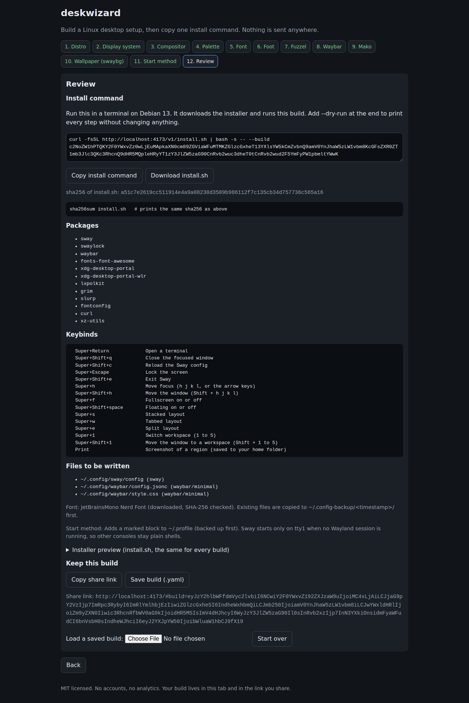

# deskwizard

deskwizard is a free, static web wizard that builds a Linux desktop setup for Debian 13 "trixie" with Sway,
then gives you one install command for it. There is no backend, no account and no analytics. The build lives in
your browser tab and in the share link. MIT licensed.

<!-- Screenshot: docs/wizard.png (captured by the wizard-e2e CI job, see CONTRIBUTING.md) -->


## Read this first

The install command runs a shell script as your user, and the script uses `sudo` to install packages. **Read the
script before you run it.** The steps below download it, check its checksum and show it to you.

## Install (read first, then run)

The wizard's Review page shows the exact command, including the build code (`--build <code>`).

```sh
# 1. Download the installer
curl -fsSLO https://bash-gitcode.github.io/deskwizard/v1/install.sh
curl -fsSLO https://bash-gitcode.github.io/deskwizard/v1/install.sh.sha256

# 2. Check it against the checksum published with the release
sha256sum -c install.sh.sha256        # must print: install.sh: OK

# 3. Read it
less install.sh

# 4. Run it with the build code from the wizard
bash install.sh --build <code> --dry-run   # shows every change without making it
bash install.sh --build <code>
```

The checksum on the wizard's Review page must equal the output of `sha256sum install.sh`.
If it does not, stop and open an issue.

Use a tagged release if you want a fixed version: `https://github.com/bash-gitcode/deskwizard/releases` lists the
files and checksums for each tag. See [RELEASING.md](RELEASING.md).

### Versions and `/v1/`

The installer is served from `/v1/`. **`/v1/` is frozen after the v0.1.0 tag.** It does not change for any reason.
A change that alters what an installed `/v1/install.sh` does ships as `/v2/`, or as a new tag that leaves `/v1/` untouched.

## Supported scope

- **Distribution:** Debian 13 "trixie" only.
- **Desktop:** Sway (Wayland). Waybar is the bar.
- **Tools in this release:** sway, waybar (5 looks), foot, fuzzel, mako, swaybg (3 wallpapers).
- **Font:** a Nerd Font is downloaded at install time from its official release, pinned by sha256 (not redistributed here).

Packages are installed from Debian's archive. CI checks that each one has a candidate in Debian 13 on every pull request.

## Known limits

- Debian 13 only. The installer reads `/etc/os-release` and stops on other systems.
- The installer changes system configuration that Sway needs, and replaces some user config files. It backs up what it
  replaces, and `uninstall.sh` restores the latest backups. Review the Review page before you run it.
- Headless smoke tests check that each variant starts on Sway and is screenshotted. They do not check how it looks on your hardware.
- CI starts every Waybar, foot, fuzzel, mako and swaybg variant under headless Sway. That is a start-up check, not a visual review.
- The site is static. Your build is not stored anywhere else; the share link carries it.

## Uninstall

```sh
curl -fsSLO https://bash-gitcode.github.io/deskwizard/v1/uninstall.sh
bash uninstall.sh --dry-run    # shows what it would restore
bash uninstall.sh
```

It restores the latest backups of the files the installer replaced. It does not remove packages that were installed
through apt; remove those with `sudo apt remove <package>` if you want them gone.

## Test in a virtual machine

Install Debian 13 in a VM (for example with QEMU or VirtualBox) from a clean image, sign in as a normal user with sudo,
then follow the install steps above. Take a snapshot before you run `install.sh` so you can roll back.

To test the installer without changing anything, run the dry run from a checkout:

```sh
npm ci && npm run build
bash site/public/v1/install.sh --build <code> --dry-run
```

## Development

```sh
npm ci                 # also renders the wallpapers (prepare script)
npm run validate       # schemas and cross-references
npm run build          # everything, then the Vite bundle into dist/
npm run dev            # local preview
```

- [CONTRIBUTING.md](CONTRIBUTING.md): add a tool or a variant in about 5 minutes, and how CI checks it.
- [SECURITY.md](SECURITY.md): report a vulnerability privately.
- [CHANGELOG.md](CHANGELOG.md) and [RELEASING.md](RELEASING.md).
- [THIRD_PARTY.md](THIRD_PARTY.md): what is not authored here (Nerd Fonts, Debian packages).

## Layout

```
catalog/                 tools, variants, palettes, fonts, schemas (the source of truth)
scripts/                 validate, build-catalog, generate-install, checks, scaffolds
site/src/                wizard (vanilla JS), installer.sh, uninstall.sh
site/public/v1/          generated installer, manifest and data files (build output, not committed)
tests/                   unit tests (node --test tests/) and the browser click-through
```

## Licence

MIT. See [LICENSE](LICENSE).
